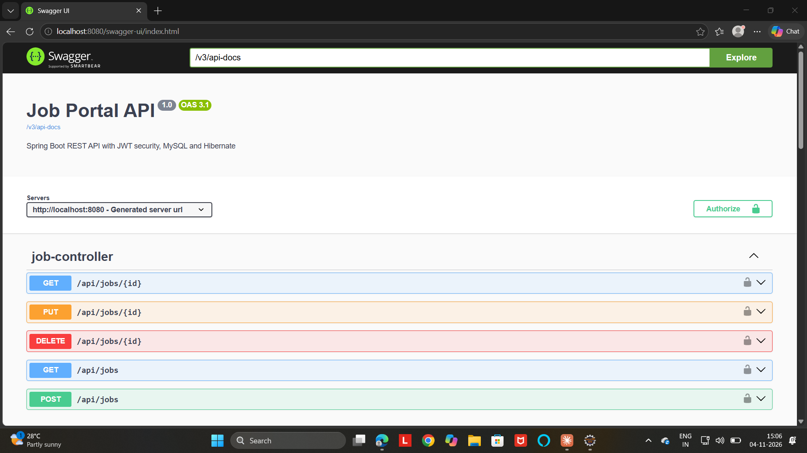
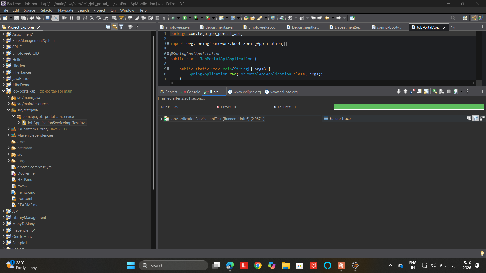
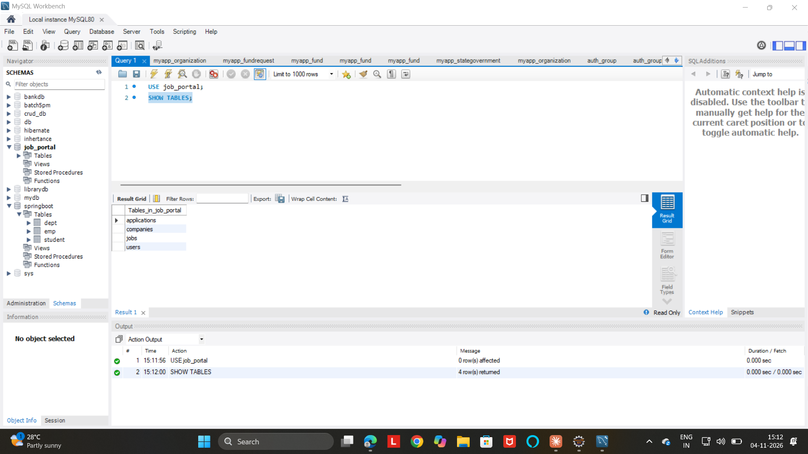

# Job Portal REST API

A backend REST API for a job portal where employers post jobs and candidates apply. Built with Spring Boot, MySQL and Hibernate, secured with JWT and role-based access.

## Features

- Company and Job CRUD with validation and global exception handling
- Job search by keyword, location and job type, with pagination and sorting
- User registration with BCrypt password hashing
- JWT login and role-based access (CANDIDATE, EMPLOYER, ADMIN)
- Candidates apply for jobs as the logged-in user, with business rules:
  - no duplicate applications
  - only candidates can apply
  - closed jobs cannot be applied to
- Employers update application status (APPLIED, SHORTLISTED, REJECTED)
- Swagger / OpenAPI documentation
- Unit tests with JUnit 5 and Mockito
- Docker and docker-compose setup
## Frontend

A React UI for this API: [github.com/teja0093/job-portal-ui](https://github.com/teja0093/job-portal-ui)

## Tech stack

Java 17, Spring Boot, Spring Data JPA (Hibernate), Spring Security, JWT, MySQL, Lombok, Swagger (springdoc), JUnit 5, Mockito, Docker, Maven

## API overview

| Method | Endpoint | Access |
|---|---|---|
| POST | /api/auth/register | Public |
| POST | /api/auth/login | Public |
| GET | /api/companies, /api/jobs | Public |
| POST, PUT | /api/companies | EMPLOYER |
| DELETE | /api/companies/{id} | ADMIN |
| POST, PUT | /api/jobs | EMPLOYER |
| POST | /api/jobs/{jobId}/apply | CANDIDATE |
| PATCH | /api/applications/{id}/status | EMPLOYER |

Job search example: `GET /api/jobs?keyword=java&location=hyderabad&jobType=FULL_TIME&page=0&size=10&sort=salary,desc`

## Screenshots







## Run with Docker

Requires Docker Desktop.

```bash
git clone https://github.com/teja0093/job-portal-api.git
cd job-portal-api
docker-compose up --build
```

Open http://localhost:8080/swagger-ui/index.html

## Run locally

1. Install Java 17+ and MySQL 8
2. Create the database: `CREATE DATABASE job_portal;`
3. Set environment variables `DB_USER`, `DB_PASSWORD` and `JWT_SECRET` (at least 32 characters)
4. Start the app:

```bash
mvnw.cmd spring-boot:run
```

(On Mac/Linux use `./mvnw spring-boot:run`.)

## How to use the API

1. Register a user at `POST /api/auth/register` with role EMPLOYER or CANDIDATE
2. Log in at `POST /api/auth/login` and copy the token
3. In Swagger click **Authorize** and paste the token

## Run tests

```bash
mvnw.cmd test
```

## Author

Bonu Tejeswara Rao, [GitHub](https://github.com/teja0093)